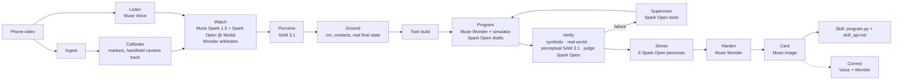

# DemoBot: show it once

**A robot learns any tabletop task from one phone video, using Meta's models.**

Film yourself doing a task once ("put the pens in the cup"). A team of agents built on Meta's models watches the video, measures every object in centimetres, writes a robot program, tests it on a simulated Franka Panda, checks the result with the same eyes that watched you, attacks its own program with hard layouts, hardens it, takes spoken corrections, and hands you a verified, robot-agnostic skill.

- **Live demo:** *(link added after deployment)*: replays of recorded runs, the free **Try it** page, and live runs on sample clips within a small daily budget.
- **3-minute video:** *(link added after upload)*
- Built for the **Meta Global AI Developer Hackathon** (Indie track, theme *Push the Frontier*), Oct 26 – Nov 4, 2026.

> **Build history.** This repository restarts DemoBot on Oct 31, 2026, porting tested modules (the model gateway, budget ledger, goal predicates, media checks, and the PyBullet scene and skills) from the author's first repository of the same event (Oct 27–30, 2026), which was later deleted. All code was written during the event. Built with Claude Code as the coding tool; all AI inside the product runs on Meta's models.

## What it does: six moments

1. **It watched me once.** SAM 3.1 masks with track IDs and motion trails on your video; a timeline of every step, grasp and release; narration (English, Hindi, Bengali) as captions.
2. **It wrote its own robot program.** Muse Wonder writes Python against a small skill API and debugs it with tool calls to the simulator: clauses go red, then green; every version has a diff.
3. **It checks itself with the same eyes.** The twin is rendered from your phone's pose; SAM 3.1 segments it the way it segmented your video. Symbolic, real-world and perceptual checks, plus an open-weight judge.
4. **It attacks itself.** Six Muse Spark Open personas propose twelve hard layouts in parallel; Wonder hardens the program until it survives them.
5. **Talk to it.** "No, the pen goes to the left of the box": the correction becomes a goal diff and a code diff, and the robot complies.
6. **Your turn.** Drag objects in the 3D twin; the robot re-plans and does it, live and free.

## How Meta's models are used

| Capability | Meta model | Its job in DemoBot |
| --- | --- | --- |
| Watch | **Muse Spark 1.3** (video) | Turns the demo video and narration into a `TaskSpec`: objects, timed steps, a declarative goal, a generalisation rule. Answers the supervisor's targeted "rewatch" questions. |
| Listen | **Muse Voice Transcribe** | Narration and spoken corrections in English, Hindi and Bengali. |
| See | **SAM 3.1** (video and image) | Pixel-precise, identity-preserving tracks of every object and the hand; also segments the simulator's render to close the loop. |
| Program | **Muse Wonder** (agentic coding) | Writes and debugs the robot program with tools (simulate, inspect the demo, check reach, submit); hardens it; applies corrections as goal and code edits; arbitrates when two watchers disagree. |
| Supervise | **Muse Spark Open** (open weights, Baseten; Modal fallback) | Decides how to recover from a failed check, with tools (rewatch, retrack, revise the spec, reprogram, accept with a caveat). |
| Red team | **Muse Spark Open** swarm (Baseten, parallel) | Six adversarial personas propose hard but solvable layouts. |
| Judge | **Muse Spark Open** (images) | Compares your real final frame with the twin rendered from your camera's pose. |
| Second opinion | **Muse Spark Open on Modal** (video) | Watches the same clip independently; disagreement triggers Wonder's arbitration. |
| Illustrate | **Muse Image** | Skill cards (anchored edits of your final frame) and the synthetic test set's object textures. |

Every model call goes through one gateway that caches it, prices it, enforces per-provider caps and logs a `model_call` event (model, provider, latency, tokens, cost, cache hit). The UI shows these live, including the open-weight share.

## Architecture



Runs are event-sourced (`data/runs/<id>/events.jsonl` plus artifacts), so every run replays exactly, restarts resume at $0, and the UI renders only from events.

## Results

<!-- results:start -->
*(copied from `eval/results.md` by `scripts/update_readme.py`)*
<!-- results:end -->

## Run it yourself

```bash
uv sync && (cd frontend && npm ci --legacy-peer-deps && npx vite build)
DEMOBOT_MODE=replay uv run uvicorn demobot.api:app --app-dir backend --port 8000   # no keys needed
# open http://localhost:8000: replay the baked runs; Try it works (simulation is free)
```

With keys in `.env` (see `.env.example`): `make dev`, then upload a clip, or `uv run demobot run my_clip.mp4`. Print `assets/print/markers.pdf` and glue the four markers around your work area; film from the robot's side (handheld is fine).

## Exported skills

Each learned skill exports as a zip: `program.py` (`run(scene, robot)`), `skill_api.md` (the contract: a `scene` that reports objects in table centimetres and a `robot` with six primitives), `goal.json`, `taskspec.json` and the card. Implement `skill_api.md` on any robot stack and the program runs there; check the result with `goal.json`.

## Limitations, stated honestly

- **Simulation only.** The robot is a simulated Franka Panda in PyBullet; no physical robot was used. The exported program is robot-agnostic, but it has not run on hardware.
- Rigid objects on a table; no stacking, deformables or force-controlled tools.
- The four printed markers must be visible; tall objects must not hide them.
- Heights come from the vision model's estimates, so parallax correction is approximate; objects inside containers are placed at the container.
- SAM can miss simple synthetic stand-ins in renders; the perceptual check then reports *inconclusive* instead of passing or failing.
- Cost per skill is real money (see Results); every call is cached, so replays and restarts are free.

## Related work and credits

- **SeeDo** (Wang et al., arXiv 2410.08792): learning robot plans from demonstration videos with vision-language models.
- **Code as Policies** (Liang et al., 2022): language models writing robot policy code.
- **SAM 3** (Meta), the **Meta Model API** documentation, **PyBullet**, and the **Franka Panda** URDF from `pybullet_data`.

## Licence

MIT
