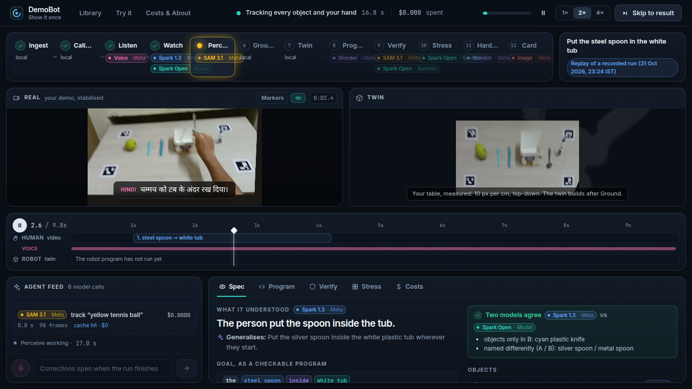
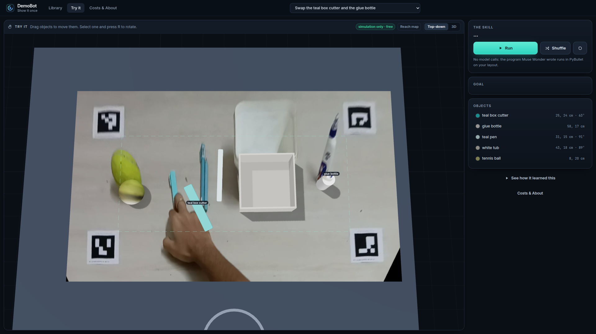
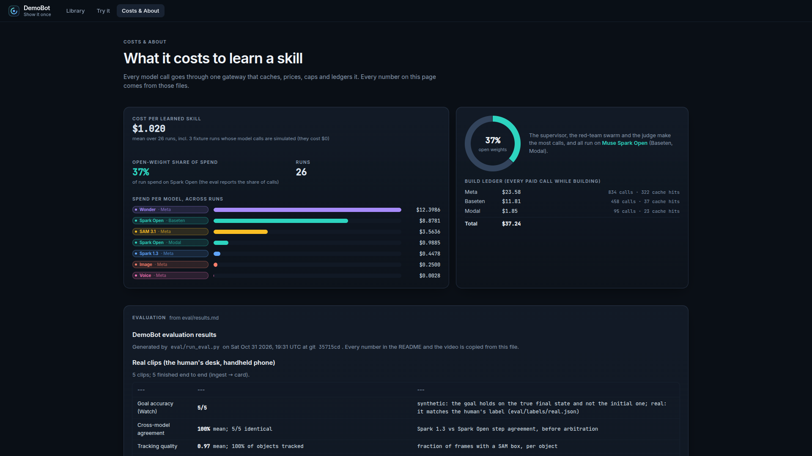

# DemoBot — Show it once.

**A robot learns a tabletop pick-and-place task from one phone video, using Meta's models.**

Film yourself doing a task once — put the spoon in the tub, move every pen right of the box — and DemoBot watches the video, works out what you meant (not just what you did), writes a robot program, tests it on a simulated Franka Panda, attacks its own work, fixes what breaks, and hands you a verified, robot-agnostic skill you can replay, rearrange, correct by voice, and export.

| | |
| --- | --- |
| **Live demo (judge mode)** | https://soubhagyaraha24--demobot.us-east.modal.run |
| **Demo video (3 min)** | *link added after upload* |
| **Built for** | Meta Global AI Developer Hackathon 2026 · *Push the Frontier* · Indie Hackers track |
| **Status** | 5/5 real phone clips and 10/10 synthetic clips learned end to end; 202 backend + 19 frontend tests green |



## The story

Teaching a robot today means teleoperation rigs, kinesthetic guiding, or code. DemoBot asks for the one thing every human already knows how to do: **show it, once, on your phone, while saying what you are doing.**

Six moments, one per skill:

1. **It watched me once.** Your handheld clip is stabilised against four printed table markers. Every object gets a name, a measured size in centimetres, and a track. Your narration becomes captions (English and Hindi verified live; Bengali is model-supported).
2. **It understood what I meant.** Two independent Watch passes — Muse Spark and open-weight Muse Spark — read the task and must agree before anything proceeds. The goal is stored as a small checkable program (`the steel spoon inside white tub`), never as prose.
3. **It checked itself with the same eyes.** The twin is rendered from your phone's camera pose; SAM 3.1 segments it the way it segmented your video. A skill passes only when symbolic, real-world and perceptual checks plus an open-weight judge agree — inconclusive counts as *not passed*.
4. **It tried to break itself, then practised.** Seven red-team agents invent harder tables (crowded, mirrored, decoy-filled). Whatever fails becomes practice layouts, and the skill card prints its robustness before and after.
5. **It listened when I corrected it.** "Put it on the left instead" — typed or spoken — becomes a goal edit, a fresh program version, and a new card. Nothing is overwritten silently.
6. **It invented a skill it was never shown.** From low-level primitives, Muse Wonder authored `rotate_in_place`, wrote its own tests, and earned promotion only after passing 10/10 fresh layouts plus a 100-run regression gate.



## What you can do on the site

- **Library** — every learned skill with its cost, robustness and version history.
- **Replay (mission control)** — your video and the twin, frame-synced, with the full agent feed: what each model saw, decided and spent.
- **Try it** — drag objects to a new arrangement, shuffle, or pick a goal chip; the skill runs on your table in seconds (free, no model calls).
- **Correct it** — type or speak a correction; watch a new version get written and verified.
- **Costs & About** — every model call, priced, with the open-weight share.



## Results

Generated by `eval/run_eval.py` into [eval/results.md](eval/results.md); every number below is copied from there.

| Metric | Real clips (5, my desk) | Synthetic clips (10, exact truth) |
| --- | --- | --- |
| Finished end to end | **5/5** | **10/10** |
| Goal accuracy (Watch) | **5/5** | 9/10 |
| Cross-model agreement | 100% mean | 85% mean |
| Tracking quality | 0.97 mean | 0.80 mean |
| Program success | **5/5** | **10/10** |
| Robustness (red-team, before → after) | 74% → 82% | 89% → **95%** |
| Correction success | **2/2** | **2/2** |
| Cost per skill | **$0.67** mean | — |
| Time per skill | 5.1 min mean | — |

Calibration on handheld clips: 10/10 pass, marker error ≤ 0.41 cm. Injected verify faults: 5/5 caught. Supervisor recovery: 4/5.

## Meta's models, each where it is strongest

| Moment | Model | Job |
| --- | --- | --- |
| Listen | **Muse Voice Transcribe** | Narration and spoken corrections (English/Hindi verified; Bengali supported, clip pending) |
| Watch | **Muse Spark** + **Muse Spark Open** (two passes) | Steps, grasps, releases, and the goal — agreement required |
| Perceive | **SAM 3.1** | Masks and persistent tracks on your video and on rendered twins |
| Program | **Muse Wonder** | Writes the robot program, its tests, and new forged skills |
| Verify (judge) | **Muse Spark Open** | Independent open-weight verdict on the result |
| Stress | **Muse Spark Open** + **Muse Image** | Adversarial layouts and the thumbnails that make them visible |
| Self-hosted | **Muse Spark Open** on Baseten + Modal | The open-weight share of every run (31% of calls) |

Any disagreement between the two Watch passes, and every model choice per stage, is visible in the agent feed — nothing is hidden behind "the AI decided".

## How it works

```
phone video ─► stabilise (markers) ─► Watch ×2 ─► goal as checkable program
     │                                                    │
     └─► Perceive (SAM tracks, sizes in cm) ─► Twin (PyBullet Panda)
                                                          │
     Program (Wonder) ◄─ failures ─ Verify (4 checks + judge)
          │                                               │
          └─► Red-team ×7 ─► harden ─► Skill card ─► Export (.zip)
```

- **Goal DSL** (`inside`, `left_of`, `near`, `collinear`, `swapped`, `turned`, …) is evaluated in centimetres against measured states — the same checker grades the demo, the twin, and the red-team.
- **Skill API**: programs only call `pick`, `place_inside`, `place_at`, `push`, … with full physics in the loop; untrusted code runs in a sandbox (no imports, CPU/memory caps).
- **Supervisor**: a fixed diagnosis table routes each failure class (re-track, re-ground, reprogram, ask the human — capped at 4 decisions per run).
- **Skill Forge**: Wonder can request new primitives-level skills; promotion requires fresh-layout tests and a regression gate over the whole library.

Design notes live in [docs/](docs/) (vision, architecture, models, pipeline, agents, simulation, frontend, quality, skill API).

## Frontier features (honestly labelled)

- **Skill Forge** — `rotate_in_place` promoted (10/10 fresh, regression green). `push` not yet promoted (best attempt 50%, latest 10%): the judge site shows the Forge's results, but new forges stay in dev mode until acceptance.
- **Live Twin core** — detection→object tracking with 3-frame confirmation, smoothing and expiry (`backend/demobot/live.py`, unit-tested). The GPU endpoint and phone pages are not built yet.
- **"Did you mean…?" core** — a deterministic goal solver (`backend/demobot/goal_solver.py`, unit-tested) predicts competing interpretations and picks the layout that separates them. The question UI is not built yet.

## Run it locally

```bash
make dev        # backend :8000 + web :5173
make check      # everything CI runs, offline: lint, types, 202 backend + 19 frontend tests
```

Put keys in `.env` (see `.env.example`). Judge mode (read-only replays, try-it, costs) is the default deployment; dev mode enables uploads and live runs on your own keys with hard spend caps.

## Limitations, plainly

- The robot is simulated (Franka Panda in PyBullet). Exported skills are robot-agnostic Python; no physical arm has run one yet.
- The perceptual verify check is advisory: inconclusive on 4/5 real clips today.
- Pick-and-place family only; one arm, objects 1–25 cm, four printed markers on the table.
- Costs above exclude development re-runs; cache hits count as $0.

## Contributors

- **Soubhagya Raha** (S-Raha23) — author: filmed the demos, owns the table, keys, deploys and submission.
- **Muse Code** (powered by Muse Wonder 1.0, Meta) — coding contributor; credited as co-author on its commits.

## Licence

MIT for original code ([LICENSE](LICENSE)); vendored Franka/URDF assets keep their own licences ([LICENSES/](LICENSES/)).
